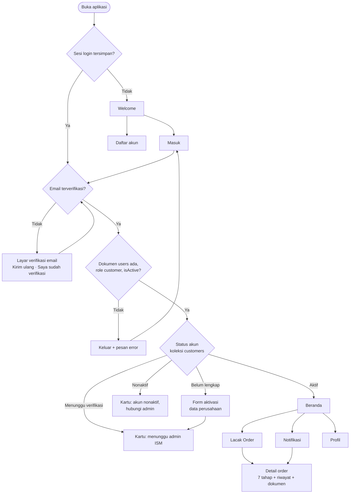
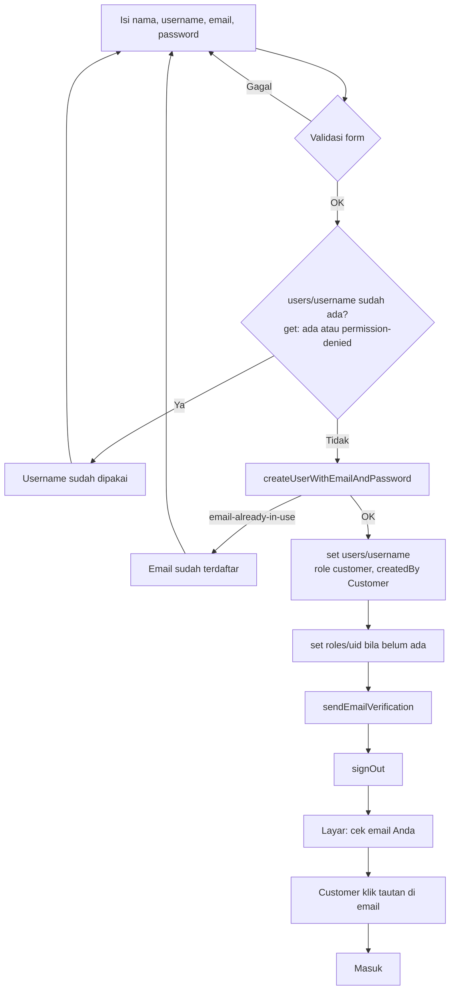
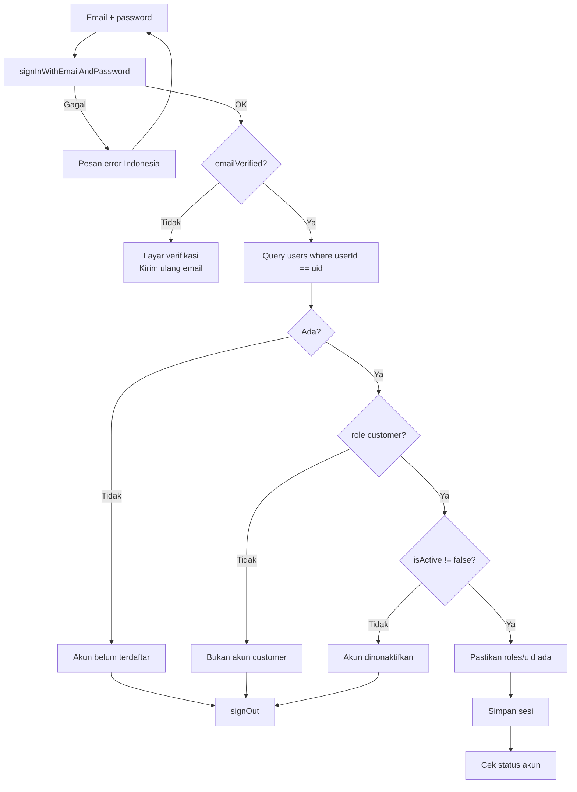
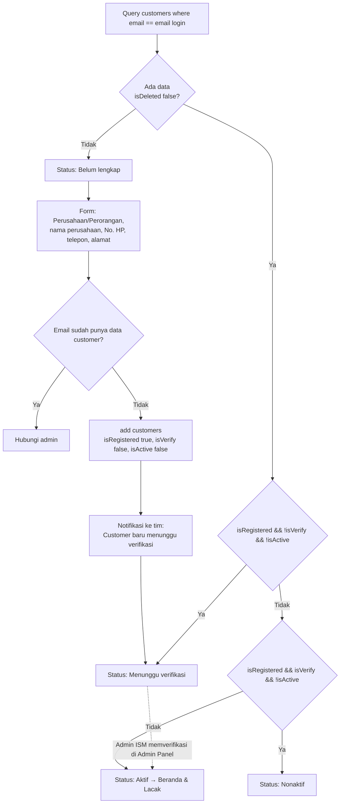
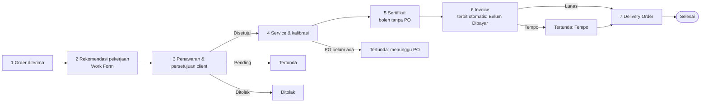
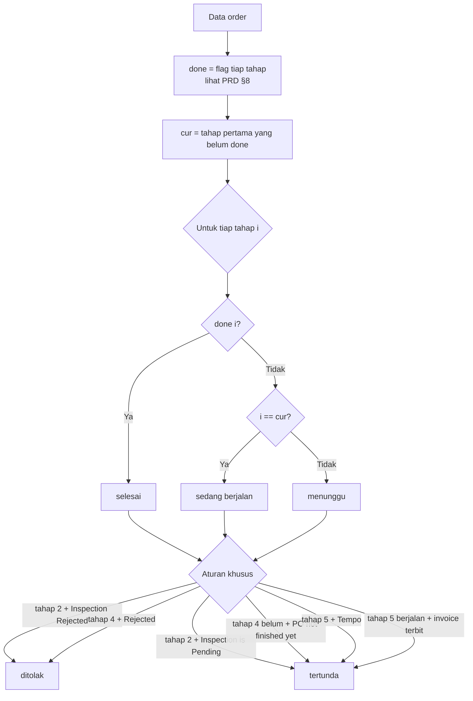
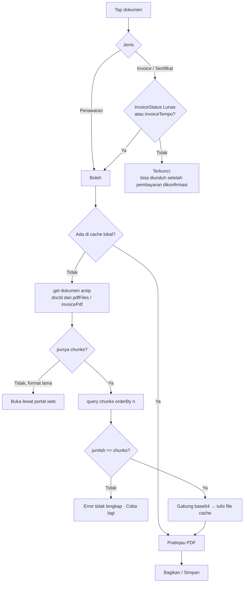
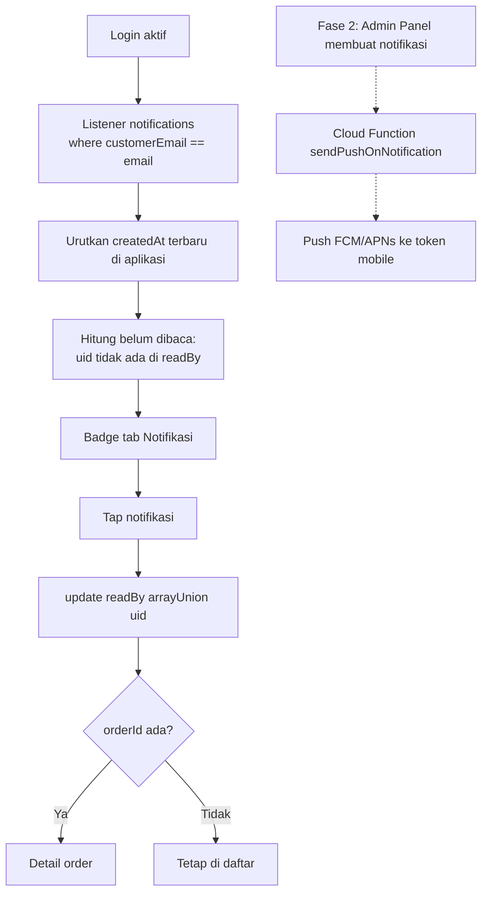
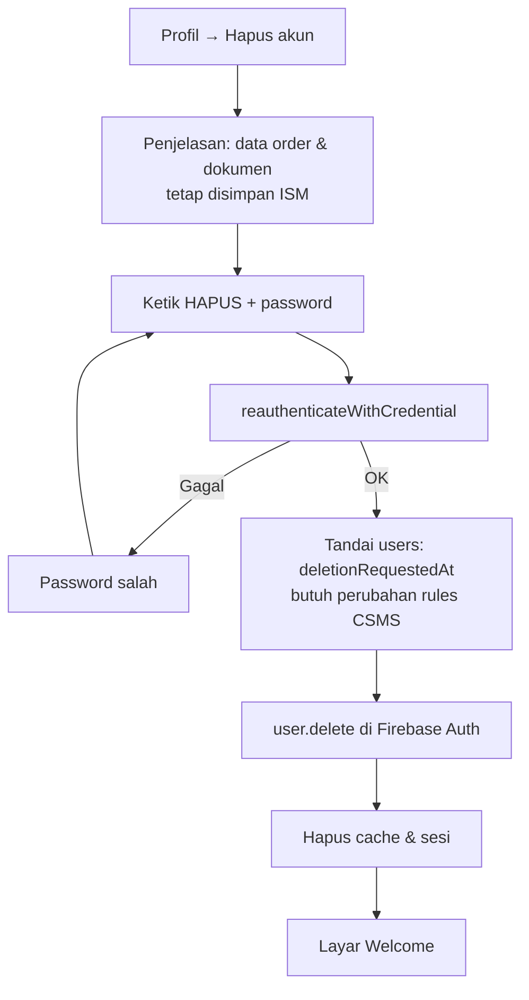
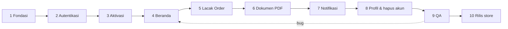

# Flowchart — Aplikasi Mobile Customer ISM CSMS

Diagram ditulis dalam Mermaid (tampil otomatis di GitHub). Acuan: [01-BRD.md](01-BRD.md), [02-PRD.md](02-PRD.md).

## 1. Alur besar aplikasi

## 2. Daftar akun & verifikasi email

## 3. Masuk (login)

## 4. Aktivasi akun

## 5. Siklus order (dikerjakan tim ISM, dilihat customer)

## 6. Penentuan status 7 tahap (logika aplikasi)

## 7. Membuka dokumen PDF

## 8. Notifikasi

## 9. Hapus akun (wajib store)

## 10. Alur pengembangan & rilis

